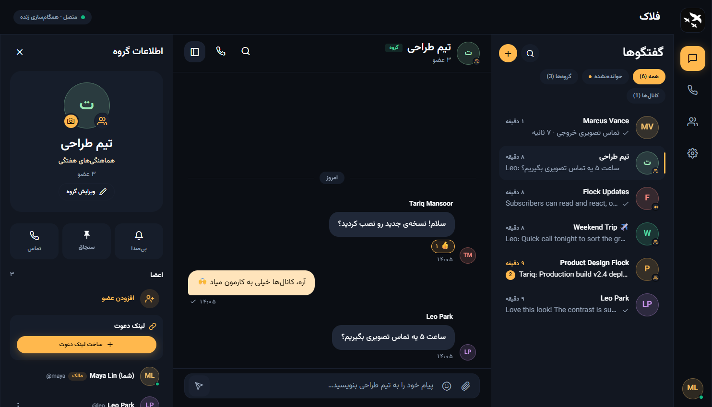

[English](README.md) | **فارسی**

<div align="center">


# فلاک (Flock)

[](https://github.com/Pourii83/Flock/releases)
[](https://github.com/Pourii83/Flock/actions/workflows/release.yml)
[](https://github.com/Pourii83/Flock/commits/main/)
[](LICENSE)

**گفتگو و تماس روی سرور خودتان، برای شما و دوستانتان**

[وب‌سایت](https://flock.beer) · [دموی زنده](https://app.flock.beer) · [مستندات](https://docs.flock.beer/fa/)

</div>

<p align="center">
  
</p>

## امکانات اصلی

| | |
|---|---|
| **گفتگو** | گفتگوی دونفره، گروه و کانال، با پاسخ، واکنش، فایل تا ۱۰۰ مگابایت و تیک خوانده‌شدن. با لینک دعوت هر کسی با یک لمس وارد گروه یا کانال می‌شود و مالک می‌تواند لینک را باطل کند. |
| **حریم خصوصی** | گفتگوی محرمانه رمزنگاری سرتاسری دارد و سرور فقط متن رمزشده را نگه می‌دارد. بقیه‌ی داده‌ها هم روی سروری می‌ماند که خودتان راه انداخته‌اید. |
| **تماس** | تماس صوتی و تصویری، دونفره یا گروهی، با تصویر تمام‌صفحه، اشتراک صفحه و حذف نویز. با لینک جلسه، مهمان‌ها بدون حساب کاربری از مرورگر وارد تماس می‌شوند. |
| **به سلیقه‌ی خودتان** | تنظیمات ادمین برای ثبت‌نام، دسترسی مهمان، محدودیت آپلود و نگهداری فایل‌ها، از داخل خود برنامه. تم روشن و تیره با هر رنگی که بخواهید. |
| **همه‌جا** | یک برنامه برای وب (PWA نصب‌شدنی)، اندروید و ویندوز، به فارسی (راست‌به‌چپ) و انگلیسی. |

## شروع سریع

روی یک سرور تازه‌ی اوبونتو یا دبیان که دامنه‌اش از قبل به آن اشاره می‌کند، اجرا کنید:

```bash
curl -fsSL https://raw.githubusercontent.com/Pourii83/Flock/main/deploy/install.sh | sudo bash
```

اسکریپت همه‌چیز را نصب می‌کند (PostgreSQL، Nginx، گواهی HTTPS و سرویس فلاک)، دامنه و حساب ادمین را می‌پرسد و پیش از شروع یک خلاصه نشان می‌دهد. بعد از نصب، هر وقت خواستید همین اسکریپت را به‌صورت منو باز کنید:

```bash
sudo flockctl
```

> [!TIP]
> اول دامنه را به سرور وصل کنید؛ مرورگرها دوربین و میکروفون را فقط روی HTTPS اجازه می‌دهند.

می‌خواهید اول نگاهی بیندازید؟ [دموی زنده](https://app.flock.beer) را امتحان کنید؛ داده‌هایش هر روز پاک می‌شود.

## مستندات

مستندات کامل در [docs.flock.beer](https://docs.flock.beer/fa/) است:

- [امتحان دمو](https://docs.flock.beer/fa/demo/)
- [شروع سریع](https://docs.flock.beer/fa/quick-start/)
- [انتخاب روش نصب](https://docs.flock.beer/fa/install/)
- [نصب با داکر](https://docs.flock.beer/fa/install/docker/)
- [اسکریپت نصب](https://docs.flock.beer/fa/install/script/)
- [مدیریت سرور با `flockctl`](https://docs.flock.beer/fa/install/script/#مدیریت-سرور-flockctl)
- [نصب آفلاین](https://docs.flock.beer/fa/install/offline/)
- [بعد از نصب](https://docs.flock.beer/fa/after-installing/)
- [تنظیمات](https://docs.flock.beer/fa/configuration/)
- [تماس بین شبکه‌ها (TURN)](https://docs.flock.beer/fa/calls/)
- [اپ‌های اندروید، ویندوز و وب](https://docs.flock.beer/fa/apps/)
- [رفع اشکال](https://docs.flock.beer/fa/troubleshooting/)
- [حریم خصوصی و رمزنگاری](https://docs.flock.beer/fa/privacy/)
- [توسعه](https://docs.flock.beer/fa/development/)

## سازنده

- نگه‌دارنده: [@Pourii83](https://github.com/Pourii83)
- مشارکت‌کنندگان: [@AlirezaNoorizadeh](https://github.com/AlirezaNoorizadeh)

## مشارکت

- از مشارکت استقبال می‌کنیم: گزارش باگ، ایده، ترجمه، نظر درباره‌ی طراحی و کد.
- پیش از یک تغییر بزرگ، در [github.com/Pourii83/Flock/issues](https://github.com/Pourii83/Flock/issues) یک issue باز کنید تا اول درباره‌اش هماهنگ شویم.
- پیش از فرستادن pull request، [راهنمای مشارکت](CONTRIBUTING.md) را بخوانید.

## حمایت

اگر فلاک به کارتان آمده، می‌توانید از توسعه‌اش حمایت کنید:

### BNB و USDT (BEP-20، شبکه‌ی BNB Smart Chain)

```
0x33F5E7CEd703f514D08361732aECed623e9DceE0
```

### TRX و USDT (TRC-20، شبکه‌ی ترون)

```
TWF2qgU9AFHHEf1TdJKnVnNjjZ1fszhitZ
```

### TON

```
UQDDkfbmIFjcGO7tyDahkuzxwJ3-PApAQHiBx6AZzfaxBzwL
```

> [!CAUTION]
> هر ارز را فقط روی شبکه‌ای که بالای آن نوشته شده بفرستید. ارزی که روی شبکه‌ی دیگری فرستاده شود از دست می‌رود.

## لایسنس

فلاک تحت [لایسنس Source-Available فلاک](LICENSE) منتشر شده است. می‌توانید از آن استفاده کنید، روی سرور خودتان نصبش کنید و در توسعه‌اش مشارکت کنید، ولی اجازه‌ی انتشار دوباره، توزیع، فروش یا تغییر برند آن را ندارید. [CONTRIBUTING.md](CONTRIBUTING.md) را ببینید.
